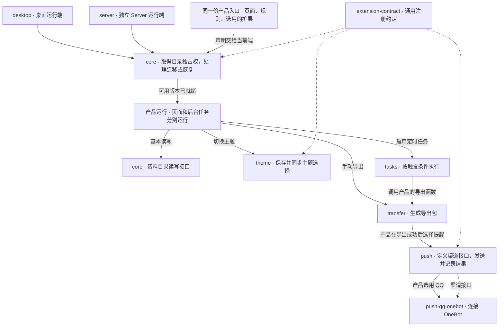

# 通用扩展规范下，哪些行为仍由 Noyau 统一执行

最小笔记产品只接入编辑和保存时，桌面 App 仍须能把资料完整交给独立 Server，升级失败也须能从原入口恢复。建议让这条路径决定 core 的职责。手动导出加入后才需要解释导出标记，自动导出加入后才需要判断一次任务能否重试。两项能力都可以由 Noyau 提供并维护，产品仍只写一份产品入口。下面的包边界是依据现有规格提出的设计，反例部分列出待实现后复验的场景。[实施规格 #18](https://github.com/jellyrain/Noyau/issues/18) · [决策索引 #1](https://github.com/jellyrain/Noyau/issues/1) · [领域术语](../../GLOSSARY.md)

## 建议的首版源码包

首版方案共九个源码包。导入导出、后台任务、主题和推送按需接入。`noyau-push` 同时向渠道作者提供推送规范，向产品提供统一的发送与查询能力。产品按需要选择运行端和能力。同一产品版本的双端继续锁定同一精确 Noyau 版本。建议首版框架自有包同步发版，验收记录核实构建实值。[产品接入决议](https://github.com/jellyrain/Noyau/issues/2#issuecomment-7163761841)

| 建议包名 | 由谁使用 | 负责的行为 |
| --- | --- | --- |
| `noyau-extension-contract` | 核心和扩展作者共用 | 定义如何声明和注册一种能力，以及运行时按约定提供的上下文。主题和推送都能沿用，具体能力自己定义字段与结果。 |
| `noyau-core` | 两端必用 | 加载同一份产品入口，装配已选能力，取得资料目录独占权并决定何时放行写入、启动任务、收尾和释放目录。内部集中实现资料的提交、迁移与恢复。 |
| `noyau-desktop` | 交付桌面 App 的产品 | Electron 窗口、产品页面、桌面升级和原图标重开。程序文件切换由桌面运行端执行，升级结果沿用共同的恢复规则。 |
| `noyau-server` | 交付独立 Server 的产品 | Fastify 网页、业务请求、本机和局域网访问、临时 key、前台停服及 `update`、`serve`。新能力的网页请求继续受同一访问规则约束。 |
| `noyau-transfer` | 选用导入导出的产品 | 按导出标记选取内容，处理包格式、加解密和校验。导出向核心取得一致快照，导入校验完成后向核心请求整份替换资料目录。 |
| `noyau-tasks` | 选用后台任务的产品 | 调度、任务标识、完成确认、安全重试与“任务结果待确认”。通过核心保存任务状态，按核心的就绪与退出通知开跑或收尾。 |
| `noyau-theme` | 选用主题的产品 | 注册主题、选默认项、保存主题选择、向已打开和重连的页面同步。产品提供样式，选择通过核心保存。 |
| `noyau-push` | 选用推送的产品及渠道作者 | 对外定义渠道标识、可用性、发送输入和回执语义。统一检查并调用已注册的渠道，通过核心保存渠道、目标及结果，供任一端查询。 |
| `noyau-push-qq-onebot` | 选用 QQ 的产品 | 实现 `noyau-push` 公开的渠道接口，对接 OneBot v11 私聊与群消息。产品在共享入口注册选用的实现包。 |

核心内部保留两个职责明确的模块。**资料目录模块**执行独占、保存、快照和整份替换，也按产品声明清理可重建缓存。**迁移与恢复模块**验证迁移保护点，协调程序与资料的配对恢复，记录升级成功。旧程序或候选程序损坏时，桌面原图标和 Server 原命令须仍能进入恢复流程，因此相应运行端应随原入口携带启动恢复所需的代码。产品单独接入编辑与保存时，以上基础行为都可用。

## 两端如何共用能力

实线表示运行或调用，虚线表示规范约束，仅列代表性约束。示例产品把“定时触发”“导出后提醒”连成一条业务流程。手动导出也能独立运行。各能力持久化的资料共用核心的提交与恢复路径。

## 外部框架能回答哪些问题

| 问题 | 一手资料中的做法 | 对 Noyau 的启发及适用范围 |
| --- | --- | --- |
| 谁定义一种能力的扩展约定？ | Backstage 后端提供创建、注册扩展点的 API，具体插件向扩展自己的模块公开接口。示例中，Scaffolder 插件实现添加 action 及拒绝重复 action 标识的逻辑，并在其模块初始化后消费注册结果。 | Noyau 可以定义通用注册机制，让推送能力定义渠道接口，让具体渠道依赖这份约定。Backstage 的初始化顺序解释了贡献何时可用。Noyau 的升级成功还取决于原资料读取和持久确认。[Backstage 后端扩展点](https://backstage.io/docs/backend-system/architecture/extension-points/) |
| 声明能力会在什么时候执行代码？ | VS Code 用静态贡献声明把命令放入命令面板，触发激活后由代码注册命令处理函数。 | 产品入口可先列出任务和推送渠道，再由持有目录的运行端按允许的阶段调用。Noyau 可用 TypeScript 表达这些声明，何时允许业务操作仍按自身的接管、迁移与升级规则决定。[VS Code 扩展结构](https://code.visualstudio.com/api/get-started/extension-anatomy) |
| 宿主插件的上下文能保证什么？ | Fastify 的子上下文默认继承父上下文的注册项，父上下文看不到子级专有项。插件也可以显式共享某些注册项。 | Fastify 能组织独立 Server 的网页和路由。桌面和 Server 在两个进程竞争同一份资料，必须另外按实际目录执行独占和恢复。Fastify 文档讨论的保证限于实例中的可见性。[Fastify 封装](https://fastify.dev/docs/latest/Reference/Encapsulation/) |

## 同一资料目录的共用路径

- **接管与退出。** 两端从同一份产品入口获取声明。运行实例取得实际目录独占权后才可打开业务资料、启动任务。退出先停止接收新写入和启动新任务，完成在途保存，待任务停止访问资料且文件关闭后释放目录。调度器可以单独交付。持有者必须能等待已接入的工作退出。[目录交接决议](https://github.com/jellyrain/Noyau/issues/3#issuecomment-7163931866)
- **提交与回执。** 页面、任务和框架能力都经同一持有者提交。成功回执只确认本次提交的版本。进程随后被强杀，接管端仍须读到整次提交，直至后续成功保存覆盖它。若回执丢失，调用方进入“保存结果待确认”，经正常读取核对。共用提交可以委托存储组件实现，最终放行写入、判定提交成功和生成回执的顺序须统一。[保存回执决议](https://github.com/jellyrain/Noyau/issues/4#issuecomment-7164239950)
- **迁移与升级。** 产品声明资料版本、迁移步骤、首次启动等待上限和就绪结果。Noyau 验证完整迁移路径，在第一步前验证迁移保护点。保护点涵盖未分类和已停用能力留下的资料，只有产品明确声明的可重建缓存可省略。升级时，新版从原资料目录正常读得预期结果，产品确认，Noyau 记下成功，三步完成才放行业务写入和后台任务。建议由相应宿主的稳定启动入口负责程序文件替换与切回，`core` 的内部模块负责资料保护点、升级成功记录和写入放行。仅启用保存的产品也走这条路径。[迁移保护点决议](https://github.com/jellyrain/Noyau/issues/10#issuecomment-7235855316) · [升级成功决议](https://github.com/jellyrain/Noyau/issues/11#issuecomment-7236116677)
- **宿主与版本。** Electron 主窗口、Fastify 路由、本机及局域网入口和临时 key 属于对应宿主。独立 Server 的访问控制要覆盖经它发起的每次业务请求，包括扩展增加的导出操作。两端实际构建均须使用产品锁定的同一精确 Noyau 版本。产物核对及旧格式样本复验属于构建和发布职责。桌面与 Server 可按产品交付范围分别打包。[共享产品入口决议](https://github.com/jellyrain/Noyau/issues/2#issuecomment-7163761841) · [网页访问决议](https://github.com/jellyrain/Noyau/issues/5#issuecomment-7164822577) · [旧格式决议](https://github.com/jellyrain/Noyau/issues/16#issuecomment-7237365011)

## 能力包拥有哪些行为

建议通用扩展规范只表达产品显式选用的能力、各贡献的身份和依赖，以及框架在哪个阶段可调用它。由加载方在开始业务工作前识别缺少的必要依赖。注册本身只提交声明，宿主通过当前阶段允许的接口发起操作。首版可由 `extension-contract` 表达共用约定，`core` 装配并管理可用阶段，`desktop`、`server` 各自提供宿主入口。各能力的执行职责如下。[产品三步接入与能力约定](https://github.com/jellyrain/Noyau/issues/18)

| 能力 | 建议的实现归属 | 产品提供的决定及其共用依赖 |
| --- | --- | --- |
| 导出、导入 | `transfer` 按任一导出标记匹配、去重，在一致快照上生成包，处理加解密、完整性校验和覆盖确认。在持有者控制下整份替换，处理中断后须能读到完整旧资料或完整新资料。 | 产品提供分类、选项、强制加密条件和覆盖提示。对资料的一致读取或整份替换须与持有者的在途写入协调。迁移保护点可以复用底层复制技术，但其覆盖范围不能取决于导出标记。[导出与导入决议](https://github.com/jellyrain/Noyau/issues/8#issuecomment-7235254380) |
| 清理可重建缓存 | 首版放在 `core` 的资料目录模块。产品按需提供清理入口，执行时只处理声明可重建的内容。 | 产品知道缩略图怎样从保留的原图重建。建议让保护点能独立读取这项声明。未提供声明时保留全部内容，未接入清理功能也能迁移。[缓存范围](https://github.com/jellyrain/Noyau/issues/8#issuecomment-7235254380) · [保护点范围](https://github.com/jellyrain/Noyau/issues/10#issuecomment-7235855316) |
| 后台任务 | `tasks` 在持有目录的一端调度，随目录记录任务标识、待执行和完成状态，对已开始的触发按产品声明判断重试或“任务结果待确认”。 | 产品定义触发条件、任务函数、安全重试策略及业务核对。运行时仅在可执行任务的阶段调用调度器。任务的保存调用依旧遵守“已保存”。[后台任务决议](https://github.com/jellyrain/Noyau/issues/9#issuecomment-7235437667) |
| 主题选择 | `theme` 按稳定标识管理可选主题和默认主题，保存选择、向打开的页面下发，处理旧选择已移除的情况。 | 产品注册并应用样式。持有者确认保存后，页面才可提示“主题选择已保存”。宿主提供页面更新的传输途径。[主题选择决议](https://github.com/jellyrain/Noyau/issues/13#issuecomment-7236427491) |
| 推送 | 推送规范包 `noyau-push` 定义稳定渠道标识、本端可用性与原因、发送和回执语义，同时统一受理发送、检查可用性、调用渠道并随资料目录保存渠道、目标和结果。`push-qq-onebot` 等推送实现包处理渠道协议，返回回执或原因。 | 产品选业务事件、渠道、目标、文本和结果呈现。框架渠道与产品渠道采用同一接口。通用加载方装配依赖，新增渠道只需实现推送规范。“渠道已接受”“发送失败”和“结果待确认”均按该规范解释。[推送决议](https://github.com/jellyrain/Noyau/issues/14#issuecomment-7236698473) |

## 哪些反例足以推翻边界

| 复验场景 | 观察结果与应调整的归属 |
| --- | --- |
| 只构建编辑和保存，两端轮流接管实际目录。App 持有时让 Server 通过符号链接打开。再让 App 保存标题和正文，在成功回执后强杀。 | Server 第一次应提示占用，第二次应完整读回新版。若必须装调度或导出包才能满足任一结果，目录独占或保存实现仍错误地依赖可选能力。[目录交接及保存验收](https://github.com/jellyrain/Noyau/issues/18) |
| 在 v1 资料中加入无导出标记的附件、停用扩展留下的记录，关闭清缓存功能。跨两步迁移，在第二步失败，再在恢复中强杀，最后让另一端接管。 | 原附件与记录应回到第一步前的值。缺失说明保护点覆盖范围误用了导出或清理规则。取消缓存声明后，应连缓存一起恢复。[迁移保护点验收](https://github.com/jellyrain/Noyau/issues/10#issuecomment-7235855316) |
| 升级时让新版从原目录读到预期结果并确认就绪，在 Noyau 写下成功前停住。此时发起保存，加入已到期的自动导出，并观察一次主题选择写入。 | 三项都不得产生业务写入或启动任务。此处强杀应恢复配套旧程序和资料。另在成功记下后保存、清理中强杀，应保留新版及新写入。一个扩展能提前落盘，就要把写入放行收回共用路径。[升级成功验收](https://github.com/jellyrain/Noyau/issues/11#issuecomment-7236116677) |
| 先只接入手动导出，再加入调度并由任务调用同一导出。另让未声明可安全重试的任务把计数加 10，提交生效后、确认任务完成前强杀。 | 第一步单独可用。第二步换端后计数仍只加 10，任务显示“任务结果待确认”。若保存回执使调度器直接认定任务已完成，需把任务状态还给任务能力。[三步接入](https://github.com/jellyrain/Noyau/issues/18) · [跨端任务决议](https://github.com/jellyrain/Noyau/issues/9#issuecomment-7235437667) |
| 让产品自写渠道实现 `noyau-push` 的公开接口并在产品入口注册。分别模拟本端不可用及发送后连接断开，再切换宿主，由产品通过同一个包查询发送记录。 | 能看到不可用原因，发送后断线记录为“结果待确认”。未声明可安全重试时不会因交接重发。若新渠道必须修改 core 的渠道枚举，或产品需要另写一套记录流程，应调整通用注册与推送规范的边界。[推送验收](https://github.com/jellyrain/Noyau/issues/14#issuecomment-7236698473) |
| 在独立 Server 开启局域网与 key 校验，从未验证的浏览器直接请求一个新扩展的导出操作。同时检查交付的桌面和 Server 构建实际解析的 Noyau 版本。 | 请求须被拒绝。若只有新路由可绕开验证，访问控制应收回宿主共用入口。任一产物与产品锁定的版本不同，都说明发布验收还缺少对实际构建的核对。[网页访问验收](https://github.com/jellyrain/Noyau/issues/5#issuecomment-7164822577) · [版本约定](https://github.com/jellyrain/Noyau/issues/2#issuecomment-7163761841) |
